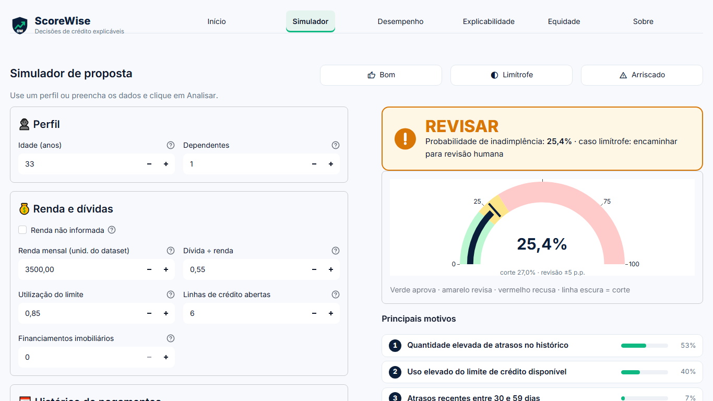

# ScoreWise

Modelo explicável de aprovação de crédito (projeto acadêmico). Para cada proposta, retorna a probabilidade de inadimplência (PD) calibrada, a decisão (aprovar / revisar / recusar) e os 3 principais motivos em português.

Dados: *Give Me Some Credit* (Kaggle). Ambiente: Windows, **Python 3.13** (a `.venv` do projeto usa o 3.13; as versões de todas as bibliotecas estão fixadas no `requirements.txt`).

> Protótipo acadêmico. As premissas de custo são ilustrativas. Não usar para decisões reais de crédito.

## Como rodar (PowerShell, na pasta do projeto)

```powershell
# 1. Instalar
python -m venv .venv; .\.venv\Scripts\Activate.ps1; pip install -r requirements.txt

# 2. Dados: baixe cs-training.csv em https://www.kaggle.com/c/GiveMeSomeCredit/data
#    (aceite as regras da competição) e coloque em data\raw\cs-training.csv

# 3. Treinar (gera models\model.joblib, ~20 s) e gerar métricas e figuras
python src\train.py; python src\evaluate.py; python src\explain.py; python src\fairness.py; python src\stats.py

# 4. Demo
streamlit run app\streamlit_app.py
```

## Demo

Seis páginas (Início, Simulador, Desempenho, Explicabilidade, Equidade, Sobre). No **Simulador**, use os perfis rápidos (Bom, Limítrofe, Arriscado) e clique em *Analisar proposta*.



Mais capturas (1366×768 e 1920×1080) em `reports/screenshots/`; para regenerá-las: `pip install playwright`, `playwright install chromium` e `python tools/screenshots.py` com o app rodando na porta 8601.

Testes: `pytest` (rode depois do treino; `test_predict.py` precisa do `model.joblib`).

## O que cada comando gera

| Comando | Saída |
|---|---|
| `python src\train.py` | `models\model.joblib`, `reports\metrics\cv_results.json` |
| `python src\evaluate.py` | `reports\metrics\test_results.{json,md}`, ROC, PR, KS, calibração, curva de lucro, matriz de confusão |
| `python src\explain.py` | SHAP global, waterfalls dos 3 perfis, `explain.json` |
| `python src\fairness.py` | `fairness.json`, `fairness.md`, `fairness_age.png` |
| `python src\stats.py` | `stats.json`: IC por bootstrap, ablação sem idade, sensibilidade de custos (~1 min) |

O treino é reprodutível: `random_state=42` e duas execuções geram o mesmo `cv_results.json`. O teste (`evaluate.py`) só é usado para a avaliação final.

## Estrutura

```
.docs/architecture.md   especificação, decisões (ADRs) e backlog
data/raw/               cs-training.csv (fora do git)
notebooks/01_eda.ipynb  EDA (figuras em reports/figures/eda_*.png)
src/                    config, data, features, train, evaluate, explain, fairness, predict
app/                    demo (streamlit_app.py, pages/, ui/)
tools/screenshots.py    capturas de tela da demo (Playwright, dev)
models/                 model.joblib (gerado, fora do git)
reports/                figures/, metrics/, relatorio.md, slides/roteiro.md
tests/                  test_data, test_features, test_predict
```

## Documentação

- Relatório: [reports/relatorio.md](reports/relatorio.md)
- Roteiro da apresentação: [reports/slides/roteiro.md](reports/slides/roteiro.md)
- Arquitetura e backlog: [.docs/architecture.md](.docs/architecture.md)
